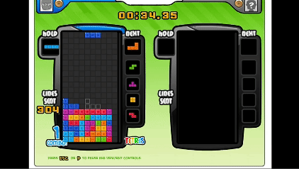

# Tetris Battle AI：以Deep Q-Learning訓練對戰型俄羅斯方塊Agent

> 2023 Mechine Learning Final Project（Team 38）。我們在經典 Facebook遊戲Tetris Battle 的 pygame 復刻版上，以 Deep Q-Learning 訓練 AI 代理人，並在與 Team 37 AI 的正式對戰中取得 **10戰9勝**。


---

## Demo

**單人模式**：AI 全程存活，並頻繁打出 Back-to-Back、Tetris 與 Combo。



**雙人對戰**：左側為 Team 38（我們的 AI），右側為 Team 37 的 AI。


## 專案簡介

Tetris Battle 是多人對戰版的俄羅斯方塊：消除行數不僅能得分，還會把灰色垃圾行送到對手畫面，讓對方更難存活。這種具競爭性的環境很適合用來測試強化學習代理人的策略決策能力。

本專案建立在 ylsung/TetrisBattle 之上，沿用其高度還原的遊戲本體與 Gym 風格的訓練環境，並在此基礎上加入狀態特徵計算、落點列舉、獎勵函數與 DQN 訓練流程。

本專案的目標是以 Q-Learning 訓練一個能在 Tetris Battle 中擊敗其他隊伍 AI 的代理人。我們設計了精簡的盤面狀態表示，並經過多次迭代調整獎勵函數，最終讓 AI 學會控制堆疊高度、避免死亡，並善用「Hold」暫存方塊來打出高分組合。

## 方法

### 狀態表示

每次放置方塊後，以 4 個盤面特徵描述狀態：

| 特徵 | 說明 |
| --- | --- |
| Lines Cleared | 本次消除的行數 |
| Holes | 上方有方塊覆蓋的空格數量 |
| Bumpiness | 相鄰兩欄高度差的絕對值總和 |
| Height | 所有欄位高度的總和 |

### 決策流程

1. **列舉所有落點**：對目前方塊（以及 Hold 交換後的方塊）列舉所有旋轉與水平位置，模擬落下後的盤面並計算上述 4 個特徵。
2. **評估與選擇**：以神經網路（4 → 64 → 64 → 1 的全連接網路）評估每個候選盤面的價值，並採用 ε-greedy 策略選出要執行的落點，ε 由 1 線性衰減至 0.001。
3. **執行動作**：將選定落點轉換成遊戲操作序列（Hold、旋轉、左右移動、硬降）送入環境。
4. **經驗回放**：將 (state, reward, next state, done) 存入 Replay Memory，隨機抽取 batch，以 Bellman 方程計算目標值並用 MSE Loss 更新網路。

### 獎勵函數

最終版本的獎勵函數以消行為主要獎勵，並對過高的堆疊與死亡施加懲罰：

```
reward = 1 + min(lines_cleared, 4)² × 10

if max_height > 10:  reward -= (max_height - 10)
if max_height > 15:  reward -= (max_height - 15)² × 5
if game over:        reward -= 1000
```

### 獎勵函數的演進

獎勵設計是本專案最關鍵的部分，以下是我們嘗試過的版本與觀察到的行為：

| 版本 | 獎勵設計 | AI 行為 |
| --- | --- | --- |
| 1 | `lines_cleared²` | 無法控制堆疊高度 |
| 2 | 改以方塊平均高度訓練 | 先往上疊高再轉為橫向堆疊 |
| 3 | 加入洞的懲罰 | 洞的權重太高會疊高塔，高度權重太高則製造大洞 |
| 4 | 加入相鄰欄高度差 | 退化成斜坡狀並留下大洞 |
| 5 | 考慮邊界方塊與空格 | 仍傾向疊高塔來規避懲罰 |
| 6（12/24 初賽） | `1 + lines_cleared² − ReLU(max_height − 10)` | 對戰全敗 |
| **7（最終版）** | 加重死亡與高度懲罰，並將 Hold 納入訓練 | **對戰 10 戰 9 勝** |

## 實驗結果

- **對戰模式**：12 月 24 日以第 6 版獎勵函數與 Team 37 進行初賽，全數落敗。改用最終版獎勵函數後，在 12 月 28 日的正式展示中以 **9 勝 1 敗** 擊敗 Team 37。
- **單人模式**：在無垃圾行、有時間限制的設定下，AI 能全程存活至時間結束，並經常打出 Back-to-Back、Tetris 與 Combo 等加分技巧。
- 最終評估使用的模型為第 10,000 個 epoch 的權重（`my_models/tetris_10000`）。

## 快速開始

### 環境需求

- Linux
- Python 3.6+
- pygame、PyTorch、NumPy、tensorboardX

### 安裝

```bash
git clone https://github.com/penny11124/Tetris-Battle-With-Q-Learning.git
cd Tetris-Battle-With-Q-Learning
pip install pygame torch numpy tensorboardX
python setup.py develop
```

### 遊玩（真人操作）

```bash
python -m game.tetris_game --mode single   # 單人模式
python -m game.tetris_game --mode double   # 雙人模式
```

### 訓練模型

```bash
python train.py
```

模型每 1000 個 epoch 會儲存一次至 `my_models/`，訓練紀錄寫入 `tensorboard/`。可透過參數調整 batch size、學習率、γ、ε 衰減等超參數，詳見 `python train.py --help`。

### 觀看 AI 遊玩

在 `test.py` 第 40 行選擇遊戲模式：

```python
# 單人模式（Team 38 AI）
env = TetrisSingleEnv(gridchoice="none", obs_type="image", mode="human")

# 雙人對戰（Team 38 AI vs. Team 37 AI）
env = TetrisDoubleEnv(gridchoice="none", obs_type="image", mode="human")
```

接著執行：

```bash
python test.py > record.txt   # 對戰結果會寫入 record.txt
```

## 遊戲規則

**遊戲結束條件**：任一玩家的方塊堆到頂端、計時結束，或手動關閉視窗。

**勝負判定**（依序比較）：先死亡者落敗 → 送出垃圾行較多者獲勝 → 堆疊頂端較低者獲勝。

**送出垃圾行的計算方式**：

| 條件 | 額外送出 |
| --- | --- |
| 一次消除 2 / 3 / 4 行 | +1 / +2 / +4（4 行即 Tetris） |
| Combo（連續消行） | +(combo + 1) / 2，最多 +4 |
| T-Spin | +3 |
| Back-to-Back（連續兩次 Tetris 或 T-Spin） | +2 |

## 專案結構

```
├── TetrisBattle/          # 遊戲本體與 Gym 風格環境
│   └── envs/
│       ├── tetris_env.py        # TetrisSingleEnv / TetrisDoubleEnv
│       └── tetris_interface.py  # 狀態特徵、落點列舉、獎勵函數
├── dqn/deep_q_network.py  # Q 網路架構
├── game/tetris_game.py    # 真人遊玩入口
├── train.py               # 訓練程式
├── test.py                # AI 遊玩 / 對戰程式
├── my_models/             # Team 38 訓練好的模型
├── Group37_model.py, tetris   # Team 37 的 AI（對戰用）
└── imgs/                  # Demo 動畫
```

## 團隊成員（Team 38）

| 成員 | 角色 | 
| --- | --- |
| Cheng-Ning Huang | Project Manager |
| Hao-Wen Hsu | Game Producer |
| Jun-Ping Chou | Algorithm Designer | 
| Pei-Jen Chen | Group Representative | 
| Po-Ching Wen | Information Gathering |
| You-Cheng Liu | Program Manager | 

## 致謝與參考資料

- 遊戲環境：ylsung/TetrisBattle（MIT License），其部分遊戲功能源自 xuyuwei/tetris-battle
- DQN 實作參考：[uvipen/Tetris-deep-Q-learning-pytorch](https://github.com/uvipen/Tetris-deep-Q-learning-pytorch)
- 理論參考：李宏毅 DRL Lecture 3: Q-learning（[shaoeChen 筆記](https://hackmd.io/@shaoeChen/Bywb8YLKS/https%3A%2F%2Fhackmd.io%2F%40shaoeChen%2FSyqVopoYr)）
- `Group37_model.py` 與 `tetris` 檔案為 Team 37 所有，僅用於對戰測試。
